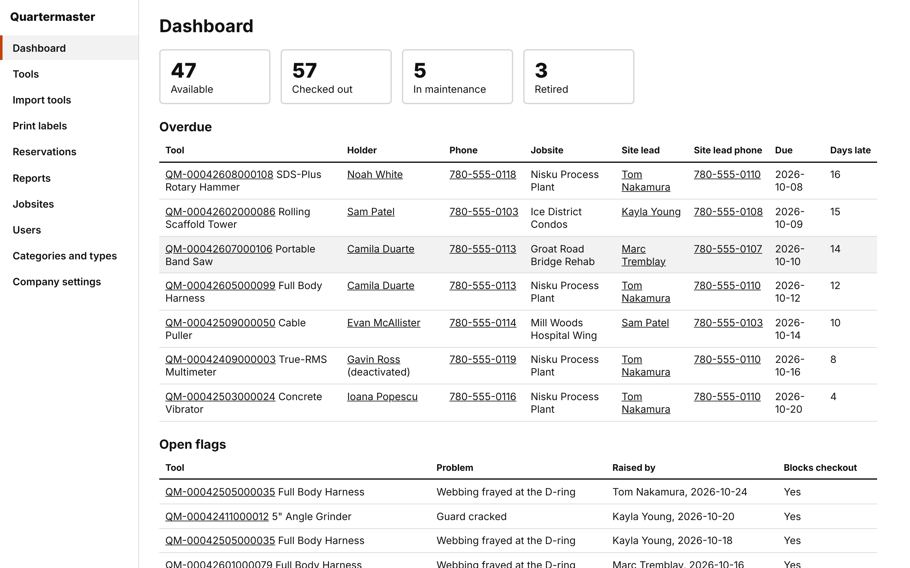
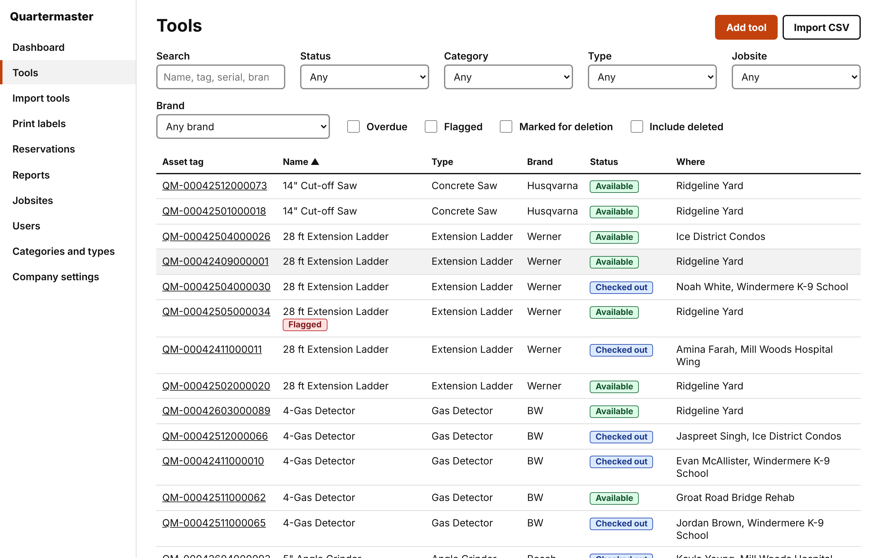
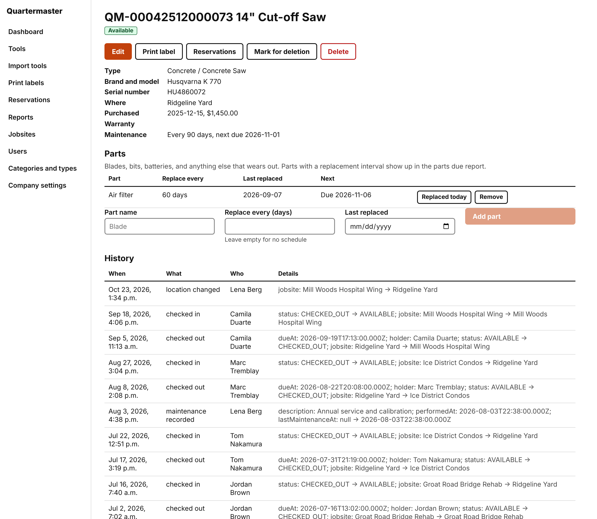
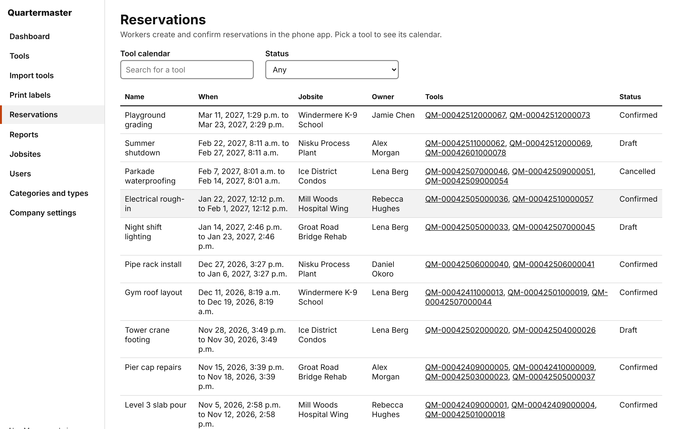
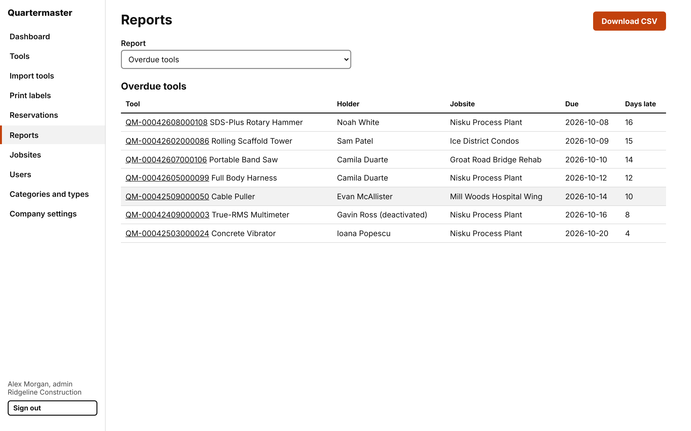
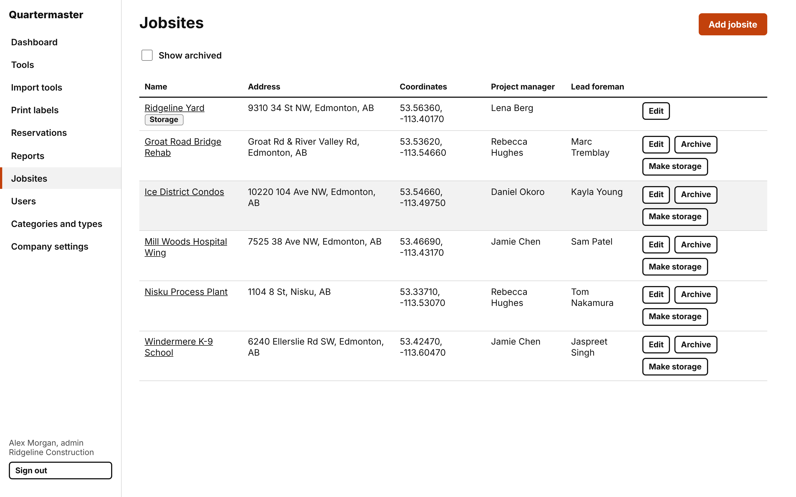
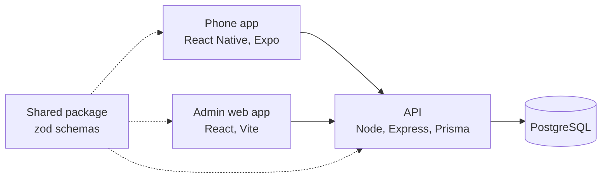

# Quartermaster

Tool tracking for construction companies. Crews check tools in and out by scanning a QR label with their phone. Managers see where every tool is, who has it, what's overdue, what's flagged as broken, and what's due for service.

I built it end to end: the API, the database design, the phone app, the admin web app, the tests, and the hosting. The source is in a private repository. This page shows what it does and how it's put together, with a few short excerpts from the code, trimmed to the part that matters.

## Try it

The admin web app is live at **[app.quartermastersite.com](https://app.quartermastersite.com)**, with a demo company, Ridgeline Construction, that has two years of made-up history.

| Company code | Username  | Password   | What you'll see                                           |
| ------------ | --------- | ---------- | --------------------------------------------------------- |
| `RIDGELINE`  | `admin`   | `password` | Everything, including users, settings, and the catalog    |
| `RIDGELINE`  | `manager` | `password` | Tools, reservations, reports, flags, jobsites             |
| `RIDGELINE`  | `worker`  | `password` | Workers use the phone app; the web app turns them away    |

Change whatever you like. The demo company rebuilds itself every week. It runs on free hosting, so the first page can take up to a minute to load while the server wakes up.

## Screenshots

The dashboard opens on what needs attention today: overdue tools with the holder's and the site lead's phone numbers, and open flags.



Every tool has an asset tag that encodes the company, the month it was added, and a running count: `QM-00512610000001` is company 0051's first tool, added in October 2026. Filters cover status, category, type, jobsite, and brand.



Each tool keeps its full history: every check-out, return, repair, flag, and note, with who did it and when. Parts that wear out (filters, blades, batteries) have their own replacement schedule.



Reservations hold tools for a crew on future dates. Check-out warns when a tool is reserved by someone else, and only a manager can override it.



Reports cover overdue tools, service due, parts due, warranties expiring, utilization, tools held by people who have left, and inventory value. Each one downloads as CSV.





The phone app (iPhone and Android) is where crews scan, check out, check in, flag problems, and make reservations. It isn't in the app stores yet, so it isn't part of the live demo.

## What it does

- Scan a tool's QR label to see it, check it out to a jobsite, or check it in. Typing the tag works too, with or without the `QM-` prefix.
- Check-outs and check-ins work with no signal. The phone queues them and sends them when it reconnects, keeping the time they really happened.
- Flag a broken tool. Managers are notified, and a flag can block check-outs until someone fixes it.
- Service intervals, part replacement schedules, and warranty dates, with reports of what's coming due.
- Reservations with conflict checks, so two crews can't book the same tool for the same days.
- Daily overdue reminders in the app, and push notifications once they're turned on for a company.
- Three roles (admin, manager, worker), enforced in the API, not just hidden in the interface.
- Many companies on one database, each completely walled off from the others.
- Bulk import from CSV, printable label sheets for common label stock, and CSV downloads of every report.

## How it's built



- One TypeScript monorepo with four workspaces: the API, the phone app, the web app, and a shared package. TypeScript is in strict mode everywhere.
- Shared request and response schemas. Every endpoint's input and output is a zod schema in the shared package. The API validates against it, the apps get their types from it, and the OpenAPI document is generated from it, so the three can't drift apart.
- API: Express 5, Prisma 7 on PostgreSQL 16, argon2 password hashing, short-lived JWT access tokens with rotating refresh tokens, per-IP and per-account rate limits on sign-in, and structured logging with pino.
- Phone app: Expo SDK 58 with Expo Router and TanStack Query. Large tap targets and high-contrast colors, since it's used outdoors with gloves on.
- Web app: React 19 and React Router with TanStack Query.
- Hosting: the API runs in Docker on Render, the database is on Neon, and the phone app ships through EAS builds and over-the-air updates.

## A few pieces worth a look

### Company data is scoped in one place

Every query on company-owned data goes through a scoped database client. The company id comes from the signed-in user and is injected into every query, so a route can't forget it and a caller can't override it.

```ts
// Injects companyId into the top-level where/data of every query on a tenant
// model, overriding anything the caller passed.
export function scopeToCompany(base: BaseClient, companyId: string): TenantDb {
  return base.$extends({
    query: {
      $allModels: {
        async $allOperations({ model, operation, args, query }) {
          if (!TENANT_MODELS.has(model)) return query(args);
          const a = { ...args };
          if (WHERE_OPERATIONS.has(operation)) {
            a.where = { ...a.where, companyId };
          } else if (operation === 'create' || operation === 'createMany') {
            a.data = withCompany(a.data, companyId);
          } else {
            throw new Error(`Tenant scope does not handle ${model}.${operation}`);
          }
          return query(a);
        },
      },
    },
  }) as unknown as TenantDb;
}
```

The database backs this up. Every reference between company records is a composite foreign key on `(companyId, id)`, so even a bug that skipped the scoped client couldn't link one company's tool to another company's jobsite.

```prisma
model Checkout {
  // ...
  tool    Tool    @relation(fields: [companyId, toolId], references: [companyId, id])
  jobsite Jobsite @relation("CheckoutJobsite", fields: [companyId, jobsiteId], references: [companyId, id])
}
```

### Every change to a tool is recorded with it

A check-out locks the tool's row, checks its status, open flags, and reservations, then writes the check-out, the new status, and a history event in one transaction. A partial unique index means a tool can never have two open check-outs, even if two phones scan it at the same moment.

```ts
const result = await db.$transaction(async (tx) => {
  const tool = await lockTool(tx, viewer.companyId, toolId); // SELECT ... FOR UPDATE
  if (tool.status !== 'AVAILABLE') throw new ConflictError('This tool is already checked out');
  // ...blocking flags, reservation conflicts...
  const checkout = await tx.checkout.create({ data: { toolId, userId, jobsiteId, dueAt } });
  await tx.tool.update({ where: { id: toolId }, data: { status: 'CHECKED_OUT' } });
  await recordToolEvent(tx, { toolId, type: 'CHECKED_OUT', before, after });
  return checkout;
});
```

```sql
CREATE UNIQUE INDEX "Checkout_one_open_per_tool" ON "Checkout"("toolId") WHERE ("returnedAt" IS NULL);
```

### Routes declare who can call them

Each route states its roles and its schemas. One wrapper handles authentication, the role check, validation of the path, query and body, the company-scoped database client, and the response shape. The same definitions produce the API documentation.

```ts
defineRoute({
  method: 'post',
  path: '/tools/:id/checkout',
  access: ALL_ROLES,
  params: idParamsSchema,
  body: checkoutRequestSchema,
  response: checkoutResponseSchema,
  status: 201,
  handler: async ({ db, user, params, body }) =>
    checkOut(db, await loadViewer(db, user), params.id, body),
}),
```

### Working with no signal

Job sites often have no signal. When a check-out or check-in can't reach the server, the phone stores it with the time it happened and sends it later. The server accepts the late time, but never earlier than the tool's last return, so the history stays in order.

```ts
export function newAction(kind, toolId, label, body, now = new Date()): QueuedAction {
  return {
    id: `${now.getTime()}-${Math.random().toString(36).slice(2, 8)}`,
    kind,
    toolId,
    label,
    body: { ...body, occurredAt: now.toISOString() },
    createdAt: now.toISOString(),
    status: 'waiting',
  };
}
```

## Testing

- About 900 automated tests: 773 for the API, 90 for the phone app, 37 for the web app, and 12 for the shared package.
- A real database. API tests run against a real PostgreSQL database, never a mocked one. Each test run makes its own databases, so test files run in parallel.
- A cross-company audit. One test walks the full list of API routes and calls every route that takes a record id as an admin of a different company. Every attempt has to come back "not found", and every list is checked for the other company's rows. A new route fails the audit until it has a case there.
- CI on every push: typecheck, lint, formatting, all test suites with coverage, a build of the phone app for iOS and Android, and a Docker build of the API that migrates a fresh database, starts, and signs in.
